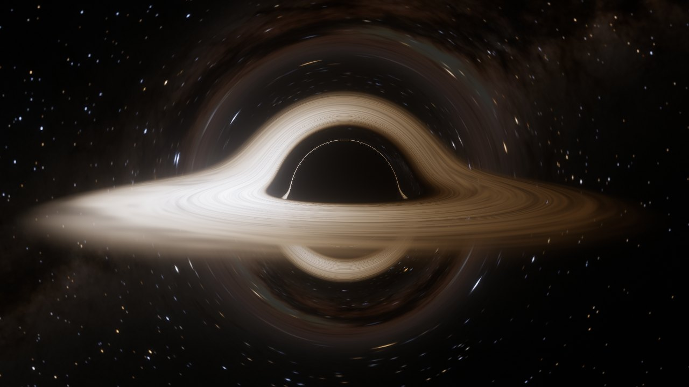
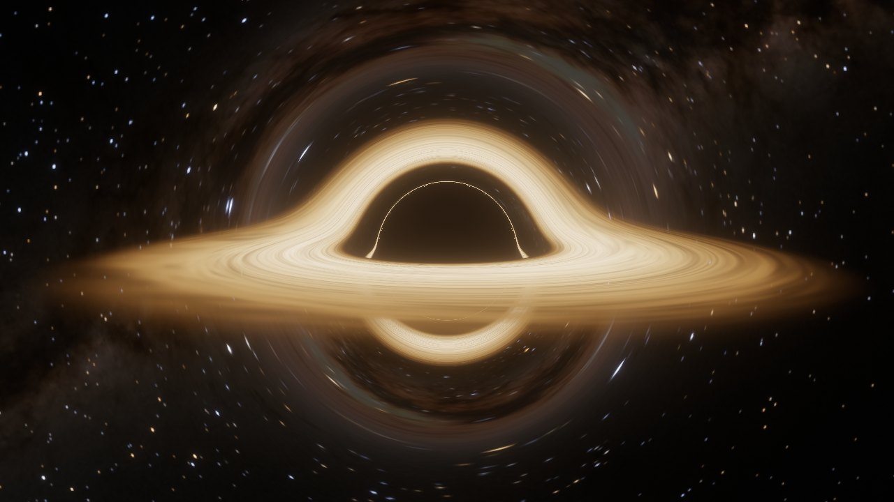
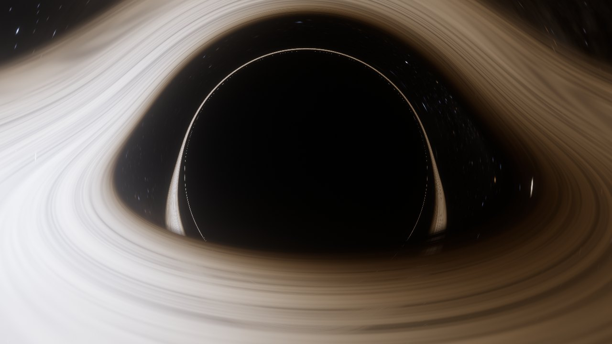
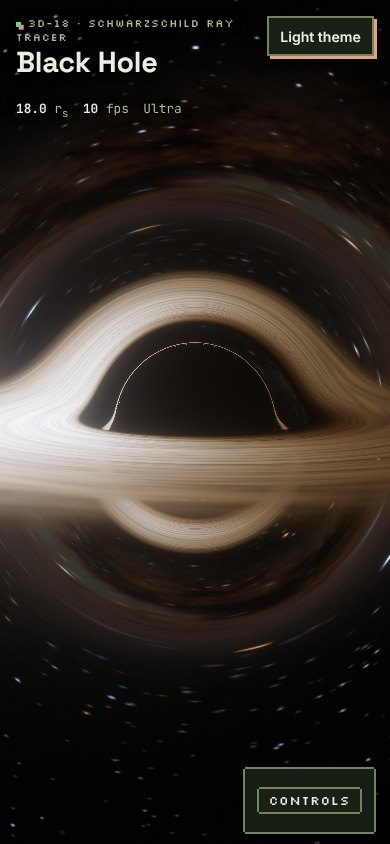

# Black Hole

A real-time black hole you can fly around, in a browser tab. Every pixel traces a ray of light backwards through the curved spacetime of a Schwarzschild black hole, so the photon ring, the shadow and the warped image of the accretion disk behind it all come out of the maths, not a texture. The near side of the disk is brightened and blued by Doppler beaming.

**Live:** https://vincentwesley.github.io/black-hole/ (after GitHub Pages is switched on, see below)



| Film look (no frequency shifts) | Close pass at 7 r<sub>s</sub> | Phone |
|---|---|---|
|  |  |  |

## What's in it
- **Per-pixel null geodesics** in a WebGL2 fragment shader (leapfrog on `x'' = -3/2 h² x / r⁵`, r<sub>s</sub> = 1), with the correct static-observer camera mapping so close passes are right too.
- **Thin Novikov–Thorne disk** from the innermost stable orbit, coloured by Planck spectra through the CIE 1931 observer; Doppler and gravitational shifts applied as T → gT.
- **Physical / Film looks**: Film switches off all frequency shifts, as the Interstellar disk did.
- **Real sky**: the 9,096 stars of the Yale Bright Star Catalogue in galactic coordinates over NASA's Gaia-based Milky Way map, with the galactic centre lensed into an Einstein ring behind the hole.
- **Bloom** (Jimenez 2014) and **ACES** tone mapping on half-float targets.
- **Quality presets** (Low/Medium/High/Ultra) plus an automatic step-down when frames get slow. Runs on software GL (SwiftShader) in headless browsers.
- Mouse, touch (drag, pinch) and keyboard (arrows/WASD, +/−, Space, R). PNG snapshot.

The maths and every source are on the page under *How it works* and *References*, and in [`docs/RESEARCH.md`](docs/RESEARCH.md).

## Run it
```bash
npm ci --ignore-scripts
npm run dev                # http://localhost:5173
npm run typecheck && npm run lint && npm test
npm run build              # dist/
npm run test:e2e           # Playwright + axe; set PW_CHROMIUM=/path/to/chromium if Playwright's browser isn't installed
```
Node 24 (`.nvmrc`). Regenerate the data files:
- stars: `npm run stars -- path/to/bsc5.dat public/data/stars.bin` (download `catalog.gz` from CDS V/50)
- Milky Way: `python3 -I scripts/build-milkyway.py milkyway_2020_4k_gal.exr public/data/milkyway.jpg` (needs numpy + Pillow; EXR from [NASA SVS 4851](https://svs.gsfc.nasa.gov/4851))

## Deploy
`.github/workflows/deploy.yml` builds and publishes `dist/` to GitHub Pages whenever `main` changes (including automerged PRs). One-time: **Settings → Pages → Build and deployment → Source: GitHub Actions**.

## Secrets and network
None. No API keys, no analytics, no third-party hosts. The page fetches only its own files (`data/stars.bin`, `data/milkyway.jpg`, fonts, images). `localStorage` keeps the theme and your control settings. The Content-Security-Policy is a `<meta>` tag in `index.html` because GitHub Pages cannot send headers.

## Docs
[`docs/PLAN.md`](docs/PLAN.md) architecture and milestones · [`docs/DECISIONS.md`](docs/DECISIONS.md) why it is built this way · [`docs/HANDOVER.md`](docs/HANDOVER.md) state and next steps · [`CREDITS.md`](CREDITS.md).

## Licence
MIT (`LICENSE`), except the credits card art (all rights reserved, `NOTICE.md`). Third-party material: `THIRD_PARTY_NOTICES.md`, `CREDITS.md`.

Provided as is, no warranty.
